# tg-companion-audit

**A hidden production screen in Telegram-iOS that feeds a vendored GLTF parser from a mutable channel.**


A review of `tg://companion` — a debug 3D-character screen that ships unconditionally in Telegram-iOS `release-13.1` … `13.2`, is reachable from any external link, and loads `.glb` assets from a public channel addressed by username. **Published: 2026-11-16** · Author: [nimo](https://github.com/Kkuwkl)

---

## TL;DR

1. **It ships.** `tg://companion` opens a debug screen in App Store builds 13.1, 13.1.1, 13.1.2 and 13.2. There is no `#if DEBUG`, no runtime flag, no `testonly`, no link-time gate: `submodules/TelegramUI/Sources/OpenUrl.swift:395-404`, `TelegramUI/BUILD:442`, `Telegram/BUILD:1887`.
2. **The error handler can kill the process.** A structurally valid 716–952-byte `.glb` with one invalid UTF-8 byte in an identifier makes `errorFor` build an `NSDictionary` literal with a `nil` value — inside the C++ `catch`, on the path that is supposed to report the error. Seven throw sites, zero `@try`, zero `NSSetUncaughtExceptionHandler`. No CVE is involved.
3. **Memory and time amplify by 66×–1147×**, and every gate passes: 2.35 MiB → 607.9 MiB, 3.63 MiB → 4.0 GiB, 32 MiB → 2115 MiB, 1.0 MiB → 175.9 s on the main thread.
4. **The catalog has no identity pin.** It is resolved by the string `"tttt3dexample"` — not by `peerId`, `accessHash`, `documentId` or a content hash — with a 48-hour cache and no `case .channel` check (`CompanionCatalog.swift:59-91`).
5. **What it takes.** Control of that channel (or of the username) plus one tap by the user on a network preset. Impact: crash, memory pressure, freeze, spoofed labels. Not code execution, not data access, not a passcode bypass.

### What this is / What this is NOT

| This is | This is NOT |
|---|---|
| A hardening and supply-chain review of shipped, reachable code | An exploitation of Telegram users; we did not attack anyone |
| A demonstration that untrusted content reaches a native parser in an App Store build | Remote code execution — there is no code-execution primitive in this build |
| A measurement of memory/time amplification through legitimate gates | Access to messages, keys, camera, microphone, or account data |
| A description of a mutable trust anchor (username) in a security-sensitive path | A passcode bypass — the screen is pushed under the lock, not above it |
| A public write-up with field-level reproduction specs, no payloads | A one-tap path to a remote `.glb` — network content needs a second tap |
| Evidence that the parser bugs are upstream `cgltf` CVEs, plus a deployment problem | Something exploitable without control of the source channel |

Everything here requires **control of the channel or the username**. Without it the only realistic outcome is self-DoS with your own file.

### If you are from Telegram

- **Look at two lines first:** `submodules/CompanionRenderer/Sources/CompanionRenderer.mm:13` (nil-unsafe `errorFor`) and `submodules/CompanionRenderer/Core/GiftModel.cpp:286` (unchecked `inverse_bind_matrices` count).
- **The vendor mail already contains** a minimal patch for both and the field-level reproduction spec; the full spec and any harness output are available on request.
- **Contact:** open an issue at [github.com/Kkuwkl/tg-companion-audit/issues](https://github.com/Kkuwkl/tg-companion-audit/issues) or reach [@Kkuwkl](https://github.com/Kkuwkl).

---

## Affected versions

| Item | Value |
|---|---|
| Application | Telegram-iOS, App Store: `release-13.1` (2026-10-20), `13.1.1`, `13.1.2`, `13.2` (2026-11-03) |
| Not affected | `release-13.0.0` and earlier; Telegram Android; Telegram Desktop; TDLib (no `companion` code) |
| Source commit | `44681a28ee4ad9792f6447a681e615a997af5323` "Experiment", 2026-10-12 16:56:23 +0400, 117 files, +46 268/−2 |
| Follow-up commit | `a8cc2ed2288e12c5b3164b2112cd1d58b8e54596` "Fix build", +38 lines, `DebugCompanionScreen/BUILD` only |
| Vendored parser | `cgltf` `85cd62382dfea638278962690cf515023f33ed00` = v1.15-11, byte-identical to upstream |
| Fix status | **Not fixed as of 2026-11-16.** Zero substantive changes across `13.1` … `13.2` / `master` |

Audited tree: `24638bc69bd083981b178dd1e7f921eebbf7fc46` (master as of 2026-11-03). All code paths below are byte-identical between that commit and `44681a28`.

---

## How the screen is reached

```mermaid
flowchart LR
    A["tg://companion<br/>external link, bot button, QR"] --> B["OpenUrl.swift:395<br/>scheme == tg && host == companion"]
    B --> C["DebugCompanionScreen<br/>pushed on root nav, no alert, no badge"]
    C --> D["CompanionCatalog(username)<br/>resolvePeerByName('tttt3dexample')"]
    D --> E["MediaBox<br/>messages.search, last .glb wins"]
    E --> F["GiftModel::load<br/>32 MiB gate -> cgltf_parse -> cgltf_validate"]
    F --> G["cgltf + OpenSubdiv<br/>Catmull-Clark, LTC tables"]
    G --> H["Metal renderer<br/>parse, subdivide and upload on main"]
```



**No gates:** no `#if DEBUG`, no runtime flag, no `testonly`, no `select()`, no peer-type check, no membership check, no confirmation — the dependency chain is plain `deps` strings from `Telegram/BUILD:1887` down to `CompanionRenderer/BUILD:15-26`.

One tap shows the screen and loads metadata plus the bundled "classic" model. A network component is a **second** tap, on a chip whose visible label is only a digit (`DebugCompanionScreen.swift:518`; the preset name appears solely in `accessibilityLabel`, `:525`).

---

## Findings

### Finding 1 — crash inside the error handler (716–952 B)

`CompanionRenderer.mm:13` converts `ex.what()` with `[NSString stringWithUTF8String:]` and puts the result straight into an `NSDictionary` literal. Seven throw sites interpolate raw bytes from the file (`CharacterInstance.cpp:15, :25, :37, :74, :165, :172, :189`); `ProfileJSON::string` accepts any byte that is non-empty, ≤256 and contains no backslash (`GiftModel.cpp:74`), and neither `jsmn` (`cgltf.h:6983-7045`) nor `cgltf_validate` (`:1597-1806`) looks at UTF-8. A single `0xFF` therefore makes the conversion return `nil`, the dictionary literal raises `NSInvalidArgumentException`, and the exception is born **inside** the C++ `catch` at `:175` / `:213`. Swift's `catch` only receives `NSError`, so the toast at `DebugCompanionScreen.swift:411` is unreachable.

Shortest trigger: a 716-byte `model` GLB with two nodes carrying the same `giftNode.id` whose bytes are `41 FF`. Other forms (socket node, animation binding) run to 952 B. The control file with ASCII `A` loads and shows a normal error. Deterministic; no dependence on heap layout, ASLR or timing.

→ [docs/en/findings.md#finding-1-crash-inside-the-error-handler](docs/en/findings.md#finding-1-crash-inside-the-error-handler)

### Finding 2 — resource amplification (66×–1147×)

| Mechanism | Input | Measured peak | Time | Code |
|---|---|---|---|---|
| 128 primitives sharing one index accessor | 2.35 MiB | 607.9 MiB CPU + ≈1.23 GB GPU | 1.62–2.02 s | `GiftModel.cpp:321-326, :385, :388`; `CompanionRenderer.mm:131` |
| 64 distinct 4096² PNG textures | 3.63 MiB | 4.0 GiB (4162.9 MiB peak) | 15.99 s (emulator) | `CompanionRenderer.mm:96, :101, :109-111, :114` |
| 64 `images[]` over one 32 MiB `bufferView` | 32 MiB | 2115 MiB (Σ 2.0 GiB) | memcpy 1.89 s | `GiftModel.cpp:170-177` |
| 2048 skins over one shared IBM accessor | 1.0 MiB | 67.0 MiB (131 GB churn) | **175.9 s on main** | `GiftModel.cpp:286-293, :19-21` |

All four pass the existing gates (`GiftModel.cpp:152-170`) and were re-run through the untouched B3 binary with `status:"ok"`. The parser itself adds ~10× on dense JSON (24.41 MB → 246 MB RSS). Two honest corrections: 64 `images[]` pointing at the *same* `bufferView` decode once (126.6 MiB) because the texture cache is keyed by content, and the 4 GiB figure needs 64 **distinct** payloads — which is cheaper for an attacker anyway.

→ [docs/en/findings.md#finding-2-resource-amplification](docs/en/findings.md#finding-2-resource-amplification)

### Finding 3 — the catalog is addressed by username

`CompanionCatalog.swift:59` calls `resolvePeerByName(name: "tttt3dexample")`; `:62-67` consumes `peer.id` with no `case .channel`; `:85-91` implements "the most recent message with the same name wins". The only filter is the `.glb` suffix and the 32 MiB cap (`GiftModel.cpp:152`). Resolution is cached for **48 hours** (`ageLimit = 2*60*60*24 = 172 800` s, `ResolvePeerByName.swift:59-69`) and the username is not part of the peer address, so a warm client keeps reading the old channel while a cold client switches immediately. Renaming or re-registering the username changes the code that runs inside the process, with no app update.

→ [docs/en/findings.md#finding-3-the-catalog-is-addressed-by-username](docs/en/findings.md#finding-3-the-catalog-is-addressed-by-username)

### Finding 4 — how this reached the App Store

One commit, 46 268 added lines across 117 files, no pull request, no tests, no fuzz target, no ASan configuration (`Components/DebugCompanionScreen/BUILD`, `CompanionRenderer/BUILD`). The commit did not build on its own — `TelegramUI/BUILD:433` referenced a package that `a8cc2ed228` added 7 m 49 s later. The feature then sat unchanged for 13–16 days and shipped: 114 paths are byte-identical across `13.1` … `13.2` / `master`. The vendored `cgltf` is pinned to 2026-02-02 with no update procedure (`ThirdParty/cgltf/SOURCE.json:3`); upstream still points at the same commit.

→ [docs/en/findings.md#finding-4-how-this-reached-the-app-store](docs/en/findings.md#finding-4-how-this-reached-the-app-store)

---

## Remediation

The snippets below are illustrative, not a patch series. None of them is applied upstream.

**1. Make the error path nil-safe, and validate identifiers at the data boundary** (`CompanionRenderer.mm:13`, `GiftModel.cpp:74`):

```objc
NSError *errorFor(const std::string &message) {
    NSString *text = [[NSString alloc] initWithBytes:message.data() length:message.size()
                                            encoding:NSUTF8StringEncoding];
    if (!text) text = @"Invalid component";
    return [NSError errorWithDomain:@"Companion" code:1 userInfo:@{NSLocalizedDescriptionKey: text}];
}
```

**2. Enforce the skeleton invariant before the joint loop** (`GiftModel.cpp:286`, one line):

```cpp
require(src.inverse_bind_matrices == nullptr ||
        src.inverse_bind_matrices->count >= src.joints_count,
        "Bind matrix count is smaller than the joint count");
```

**3. Put limits on the control fields and a budget before the expensive work** (`GiftModel.cpp:152-174`, `Subdivision.cpp:78`):

```cpp
require(raw->skins_count <= 64, "Too many skins");
require(sparse->count <= (1u << 20) && sparse->stride >= element_size, "Unsupported sparse accessor");
require(totalImageBytes <= (64u << 20), "Texture payload budget exceeded");
require(cage.faces * (1u << (2 * level)) <= 30000, "Subdivision budget exceeded");
```

**4. Pin the asset source** (`CompanionCatalog.swift:59-91`):

```swift
guard case let .channel(channel) = peer else { return }        // no users, no groups
guard channel.id == Self.pinnedPeerId,
      channel.accessHash == Self.pinnedAccessHash else { return }
guard Self.allowed[option.name] == sha256(file) else { return } // documentId + hash allowlist
```

**5. Gate the feature at build time** (`OpenUrl.swift:391-404`, `TelegramUI/BUILD:442`):

```swift
#if DEBUG
if canonicalUrl.scheme?.lowercased() == "tg", canonicalUrl.host?.lowercased() == "companion" {
    // present the screen
}
#endif
```

Or keep it in release as an explicit product decision, disclosed in App Store Connect, behind a remote flag and a confirmation for external URLs.

---

## Scope, limits, non-claims

This is a **hardening and supply-chain** review, not a report of an exploitable vulnerability in the usual sense. We read the shipped source, diffed the vendored libraries against upstream, and built standalone harnesses on x86-64 to measure what the code does with attacker-shaped files. We did **not** have an iOS device or Xcode, never inspected the App Store IPA, and never ran the app; statements about link-level presence come from the Bazel graph and linking rules, and every number about memory, time or crashes comes from Linux/Windows harnesses, not from a phone. The final Foundation link (`stringWithUTF8String:` → `nil` → dictionary literal raises) is documented API behaviour that we could not execute on this host.
There is **no RCE, no data access, no passcode bypass, no exfiltration, no write to disk, and no path to a remote asset from a single tap**. What is left is a real but bounded problem: a mutable username is the only address for code that a native parser consumes, and the error path itself is a crash. Fixing the two one-line issues and pinning the source would remove most of the practical risk; the upstream parser CVEs need a vendor update either way.

---

## Upstream CVEs (not ours)

Three `cgltf` memory-safety issues reproduce on the vendored parser: **CVE-2026-112019** (sparse-pass OOB read), **CVE-2026-32845** (sparse validation overflow) and **CVE-2026-75148** (non-sparse `req_size` overflow). A fourth, **CVE-2026-112018** (OOB write), is currently gated by call order — `cgltf_validate` always runs before `unpack_floats` (`GiftModel.cpp:163`). They were reported upstream by **HaiND**, **Asilbek Muhammadiyev** and **Ana Kapulica**, and published via NVD/VulnCheck; see [CVE-2026-112019](https://nvd.nist.gov/vuln/detail/CVE-2026-112019), [CVE-2026-112018](https://nvd.nist.gov/vuln/detail/CVE-2026-112018), [CVE-2026-32845](https://nvd.nist.gov/vuln/detail/CVE-2026-32845), [CVE-2026-75148](https://nvd.nist.gov/vuln/detail/CVE-2026-75148). Our contribution is the deployment context, not the parser bugs.

---

## Methodology and evidence

Five stands, 12 254 parser executions plus 400 release-build runs. B3: real `cgltf.h` compiled and driven in the application's call order (2 412 mutations, 36 targeted cases, 7 DoS probes, 4 valid files; 10 s timeout, 0 hangs). C01b: unmodified `GiftModel.cpp` under ASan at `-O2`, 400 runs. C02a/C02b: two independent harnesses on unmodified `GiftModel.cpp` / `CharacterInstance.cpp` with 716–952-byte payloads. C03: a line-by-line `GiftModel::load` emulator that retains every container, plus a `textureFor` emulator. → [docs/en/methodology.md](docs/en/methodology.md)

---

## Disclosure timeline

| When | Event |
|---|---|
| 2026-11-16 | Public write-up published in this repository — **before any vendor reply**. Vendor notified the same day at `security@telegram.org`, with a link to this repository and an offer of a patch. |
| 2026-11-16 | Public-report check: GitHub issues in `TelegramMessenger/Telegram-iOS`, `telegramdesktop/tdesktop`, `DrKLO/Telegram`, `tdlib/td` and `bugs.telegram.org` — **no public reports found** |
| 2026-11-16 | Status: no fix. `13.1` … `13.2` / `master` carry zero substantive changes in the companion paths |
| +90 days | Follow-up and status update; the 90-day window is the period offered for a fix, not a publication embargo — publication has already happened |

No `.glb` payloads are published. The findings contain field-level descriptions only (for example: "two nodes with identical `giftNode.id`, bytes `41 FF`"); a reproduction spec is available to the vendor on request.

---

## License and credits

MIT (see [`LICENSE`](LICENSE)). The parser CVEs belong to their reporters — **HaiND**, **Asilbek Muhammadiyev** and **Ana Kapulica**; this repository only documents how Telegram-iOS uses the affected library. Written and published by **nimo** ([@Kkuwkl](https://github.com/Kkuwkl)).

---

## Repository map

| File | What |
|---|---|
| [`docs/en/findings.md`](docs/en/findings.md) | The four findings in detail, with code excerpts and evidence |
| [`docs/en/methodology.md`](docs/en/methodology.md) | The five stands, what was measured with what, and the limits |
| [`README.ru.md`](README.ru.md) | Русская версия (Russian version) |
| [`LICENSE`](LICENSE) | MIT |
| [`SECURITY.md`](SECURITY.md) | Reporting and publication policy |

---

**nimo** · [@Kkuwkl](https://github.com/Kkuwkl) · issues: [tg-companion-audit](https://github.com/Kkuwkl/tg-companion-audit/issues)
