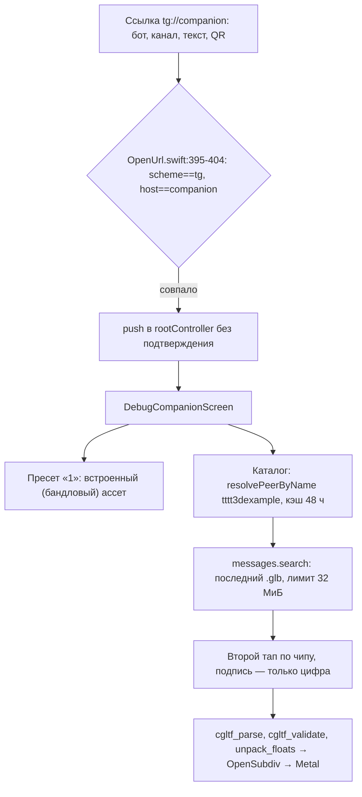

# tg-companion-audit

**Скрытый экран в production-сборке Telegram-iOS, который кормит вендоренный GLTF-парсер контентом из изменяемого канала.**

Разбор в логике hardening и supply-chain. Это не «взлом Telegram»: ни одна находка не даёт выполнения кода, доступа к данным или обхода passcode.

**Опубликовано: 2026-11-16** · автор **nimo** ([@Kkuwkl](https://github.com/Kkuwkl))

 
 

## 1. TL;DR

1. **Что нашли.** В App Store-сборке Telegram-iOS (`13.1`…`13.2`) живёт отладочный экран 3D-персонажа `tg://companion`. Он открывается обычной ссылкой, без `#if DEBUG`, без runtime-флага и без подтверждения. Внутри — Metal-рендерер, вендоренный парсер `.glb` (`cgltf`) и OpenSubdiv.
2. **Главное.** Обработка ошибок убивает процесс сама. Невалидный UTF-8 в одном из внешних полей модели превращает `[NSString stringWithUTF8String:]` в `nil`, литерал `NSDictionary` бросает `NSInvalidArgumentException` **внутри C++ `catch`**, и Swift его не видит. Детерминированный краш, файл **716–952 байта**.
3. **Амплификация.** Четыре независимых механизма, все проходят штатные гейты: **2,35 МиБ → 607,9 МиБ** (индексы), **3,63 МиБ → 4,0 ГиБ** (текстуры), **32 МиБ → 2115 МиБ** (`images[]`), **1,0 МиБ → 175,9 с** на главном потоке (скины).
4. **Модель доверия.** Каталог компонентов берётся по `resolvePeerByName("tttt3dexample")`: без пина `peerId` и `accessHash`, без проверки `case .channel`, с фильтром только по суффиксу `.glb` и лимиту 32 МиБ. Кэш резолва — 48 часов.
5. **Цена атаки.** Нужен контроль над каналом или username и второй тап по чипу с цифрой. Без этого остаётся лишь self-DoS. На 2026-11-16 фикса нет: в `13.1…13.2/master` ноль содержательных изменений.

| Что это | Что это НЕ |
|---|---|
| Разбор hardening / supply-chain по production-сборке | Не «взлом Telegram» и не уязвимость, эксплуатируемая кем угодно |
| Скрытый экран без гейта, подтверждения и пометки «debug» | Не RCE: удалённого выполнения кода нет, локальное требует записи в подписанный `.app` |
| Детерминированный краш из пути обработки ошибок на 716–952 Б | Не доступ к данным: переписка, ключи, камера и микрофон недостижимы |
| Амплификация памяти и времени на файлах, проходящих валидацию | Не обход passcode: экран уходит под слой блокировки, но лок не снимает |
| Модель доверия, построенная на изменяемом username | Не «один тап до чужого `.glb`»: сетевой контент — второй тап по чипу с цифрой |
| Повод пересмотреть поставку стороннего кода в клиент | Не атака без контроля канала: подписчик канала не может ничего |

Source: `FACTS.md` §«Позиционирование», §«Что входит в публичную версию».

**Если вы из Telegram**

1. Начните с `Sources/CompanionRenderer.mm:13` и `Core/GiftModel.cpp:286` — этих двух мест хватает для триажа, сборка не нужна.
2. В письме — патч по обоим местам и репро по запросу; готовый `.glb` в публичной версии отсутствует намеренно.
3. Ответ принимается в GitHub issues этого репозитория или в профиле [@Kkuwkl](https://github.com/Kkuwkl).

## 2. Затронутые версии

| Что | Значение |
|---|---|
| Приложение | Telegram-iOS из App Store: `release-13.1` (2026-10-20) … `13.2` (2026-11-03); также `13.1.1`, `13.1.2` |
| Не затронуто | `release-13.0.0` и раньше; Telegram Android; Telegram Desktop; TDLib |
| Коммиты | `44681a28ee4ad9792f6447a681e615a997af5323` «Experiment», 2026-10-12 16:56:23 +0400, `+46 268/−2`, 117 файлов; затем `a8cc2ed228…` «Fix build», `+38`, только `DebugCompanionScreen/BUILD` |
| `cgltf` | `85cd62382dfea638278962690cf515023f33ed00` = v1.15-11, байт-в-байт upstream |
| OpenSubdiv | `9dab8a47` = Release 3.7.0, 72 из 72 файлов байт-в-байт |
| Статус фикса | Не исправлено на 2026-11-16 |

Source: `FACTS.md` §«Затронутые версии».

## 3. Как открывается экран

Точка входа — точное сравнение в `OpenUrl.swift:395-404`: `scheme == "tg" && host == "companion"`. Дальше — push в `rootController` без диалога. Линковка безусловная: `TelegramUI/BUILD:442`, `Telegram/BUILD:1887,986`. Ни `#if DEBUG`, ни runtime-флага, ни `testonly` в цепочке нет.



- **Сетевой контент — это второй тап.** Первый показ всегда берёт встроенный (бандловый) ассет; на чипе видна только цифра — ни имени файла, ни источника, ни размера, название пресета уходит в `accessibilityLabel`. **Passcode при этом не обходится:** слой блокировки выше по z-порядку, но экран под ним не снимается — идут компиляция шейдеров и загрузка каталога, а после разблокировки экран интерактивен без действий пользователя.

Source: `FACTS.md` §«Точка входа»; `docs/ru/findings.md` §1.

## 4. Находка 1 — краш в обработке ошибок

Файл `716–952 байта`. Ни одного CVE, ни одной структуры памяти, ни таймингов: достаточно одного невалидного байта в идентификаторе. Строки приходят из `giftNode.id`, `giftSlot`, `sockets[].node` и `GIFT_animation_binding.node`.

```objc
// схема дефекта, Sources/CompanionRenderer.mm:13
[NSString stringWithUTF8String:ex.what()]   // невалидный UTF-8 → nil
@{ @"key": <этот nil> }                     // литерал → NSInvalidArgumentException
```

Дальше срабатывает один из семи throw-сайтов в `CharacterInstance.cpp`, исключение всплывает в C++ `catch` и там встречает `errorFor`. `@try` в таргете — ноль вхождений, `NSSetUncaughtExceptionHandler` — тоже ноль. Swift ловит только `NSError`, поэтому процесс убит, а тоста нет. Воспроизведено на неизменённом коде, вплоть до `errorFor` включительно.

Source: `FACTS.md` §«Что входит в публичную версию», п. 1; `docs/ru/findings.md` §2.

## 5. Находка 2 — амплификация

Все четыре замера сделаны на файлах, которые проходят штатные гейты: лимит 32 МиБ, `count ≤ 1e6`, проверки `validateCage`. Лимиты пообъектные, произведения никто не считает.

| Механизм | Файл | Результат | Время |
|---|---|---|---|
| Индексы: лимит на примитив, не на модель | 2,35 МиБ (2 460 632 Б) | 607,9 МиБ CPU, `Σ p.indices` 585,9 МиБ, плюс GPU ≈1,23 ГБ | 1,6–2,0 с |
| 64 разных PNG в RGBA8 | 3,63 МиБ (3 806 732 Б) | 4,0 ГиБ (пик 4162,9 МиБ) | 16 с |
| `images[]`: копия всего `bufferView` без дедупликации | 32 МиБ (33 554 432 Б) | 2115 МиБ (`Σ` 2 147 202 304 Б) | memcpy 1,89 с |
| Скины: `floats()` внутри цикла по `skins_count` | 1,0 МиБ (1 053 600 Б) | пик 67 МиБ, но 175,9 с на главном потоке | 175,871 с |

Механизмы разные, поэтому и фиксы разные: счётчик `Σ p.indices`, бюджет пикселей, дедупликация по `bufferView`, лимит `skins_count` и кэш «один accessor — один разбор». Общий у них только корень: нет суммарного бюджета до аллокаций.

Source: `FACTS.md` §«Что входит в публичную версию», п. 2; `docs/ru/findings.md` §3.

## 6. Находка 3 — модель доверия

Каталог привязан к имени, а не к пиру. `resolvePeerByName("tttt3dexample")` возвращает `peerId`, но выборка документов от него не зависит: `peerId` и `accessHash` не пинятся, тип пира не проверяется, `case .channel` отсутствует. Каталогом становится любой пир — группа с открытым постингом или пользователь, у которого в личке лежат `.glb`. При этом `@tttt3dexample` — публичный канал: писать в него подписчик не может, поэтому модель доверия ломается не «любым желающим», а тем, кто получил контроль над каналом или над самим username.

| Проверка | Есть? | Следствие |
|---|---|---|
| Пин `peerId` + `accessHash` | Нет | Смена владельца или типа пира молча меняет код в процессе |
| `case .channel` | Нет | Каталогом может стать группа или личный чат |
| allowlist `(documentId, sha256)` | Нет | Подмена файла под тем же именем не видна |
| Фильтр по суффиксу `.glb` и 32 МиБ | Да | Единственный барьер на входе в нативный парсер |
| TTL кэша резолва | 48 ч (172 800 с) | «Тёплый» клиент до двух суток ходит в старый канал, «холодный» переключается сразу |

Source: `FACTS.md` §«Что входит в публичную версию», п. 3; `docs/ru/findings.md` §4.

## 7. Находка 4 — процесс

| Факт | Значение |
|---|---|
| Объём и ревью | `+46 268/−2`, 117 файлов одним коммитом; PR нет, один автор |
| Сборка | Первый коммит не собирался: `TelegramUI/BUILD:433` ссылался на несуществующий пакет |
| Починка | `a8cc2ed228` «Fix build», `+38`, только `BUILD` |
| Жизнь после заливки | 0 содержательных правок, 114 путей байт-в-байт в `13.1…13.2/master` |
| Окно до App Store | 13–16 суток |

Отсюда практический вывод: 42 884 строки вендоренного 3D-стека попали в клиент без отдельного ревью и без тестов. Именно поэтому ни «Debug-экран в проде», ни устаревший пин парсера не были замечены до публикации.

Source: `FACTS.md` §«Что входит в публичную версию», п. 4; `docs/ru/findings.md` §5.

## 8. Ремедиация

Пять действий, в порядке убывания отношения «эффект / цена». Первые два закрываются чтением диффа, без сборки.

**1. Nil-safe конверсия и валидация строк.**

```objc
// Sources/CompanionRenderer.mm:13
NSString *s = [[NSString alloc] initWithBytes:raw.data() length:raw.size()
                                encoding:NSUTF8StringEncoding] ?: @"";
// Core/GiftModel.cpp:74 — алфавит [A-Za-z0-9._:-], длина ≤ 64
require(isValidIdent(raw));
```

**2. Сверка палитры скелета с числом суставов.**

```cpp
// Core/GiftModel.cpp:286, до цикла на :289 — закрывает чтение за границей буфера
require(src.inverse_bind_matrices == nullptr ||
        src.inverse_bind_matrices->count >= src.joints_count,
        "inverseBindMatrices shorter than joints");
```

**3. Лимиты на управляющие поля и общий бюджет.** Пообъектные проверки бесполезны, пока не ограничено произведение.

```cpp
require(src.sparse_count <= 1u << 20 && src.byte_stride >= element_size);
require(src.byte_offset <= view->size && model.skins_count <= 16);
require(sum_images_bytes <= 64u << 20);
require((uint64_t)n_faces * (1ull << level) <= 30000);
```

**4. Пин канала и allowlist документов.** Единственный вектор с ненулевым эффектом сегодня закрывается здесь.

```swift
// CompanionCatalog.swift:59-91
guard case let .channel(ch) = peer else { throw CatalogError.notChannel }
guard ch.id == pinnedPeerId, ch.accessHash == pinnedAccessHash else { throw CatalogError.peerMismatch }
guard allowlist[doc.id] == doc.sha256 else { throw CatalogError.digestMismatch }
```

**5. Решение по самому экрану.** Либо гейт, либо явное продуктовое решение с раскрытием в App Store Connect.

```swift
#if DEBUG
    // экран собран только в debug-конфигурации
#endif
// либо remote flag + подтверждение перед показом для внешних tg://
```

Отдельно: не «оптимизировать» порядок `cgltf_load_buffers` → `cgltf_validate` → чтения. Сейчас это единственный барьер, который держит запись за границей буфера; при рефакторинге нужен тест-сторож.

Source: `FACTS.md` §«Ремедиация».

## 9. Методика и доказательства

33 агента, 4 волны: 16 сборщиков фактов, 3 теоретика цепочек (67 цепочек), 13 проверяющих (46 цепочек разобрано) и валидатор. Итог: 16 цепочек выжили, 12 частично, 13 мертвы, 5 решает только устройство, 21 осталась теоретической. Эмпирика — отдельные стенды на x86_64: 12 254 прогона настоящего `cgltf.h` в порядке вызовов приложения, 2 412 детерминированных мутации, четыре стенда фазы проверки, включая сборку неизменённого `GiftModel.cpp` с ASan и 400 релизных прогонов. Каждое утверждение либо воспроизведено, либо помечено как вывод по коду — разбор в `docs/ru/methodology.md`.

Source: `docs/ru/methodology.md`; `THREAT-MODEL.md` §8.

## 10. Границы и что мы НЕ утверждаем

- **Нет RCE.** Выполнения произвольного кода нет: удалённо — ни при какой полезной нагрузке, локально — только при записи в подписанный `.app`, то есть вне сетевой модели.
- **Нет доступа к данным.** Ни переписки, ни ключей, ни камеры, ни микрофона, ни денег. В первопартийном коде нет клиента «наружу» и нет записи на диск.
- **Нет обхода passcode.** Экран оказывается под слоем блокировки по z-порядку и не снимается, но разблокировку не обходит.
- **Нет «одного тапа до чужого `.glb`».** Первый тап по чипу «1» открывает встроенный (бандловый) ассет. Сетевой контент — второй тап по чипу, у которого подпись — цифра.
- **Нужен контроль канала.** Без контроля `@tttt3dexample` или username сценарий сводится к self-DoS; подписчик публичного канала не может ничего.
- **F-01 — дефект с ограниченным эффектом.** Чтение за границей буфера доказано ASan на неизменённом коде, но эффект визуальный: 0 падений на 400 прогонов. Подаём как «доказанный дефект памяти», не как краш.
- **CVE не наши.** Публикации CVE-2026-112018, CVE-2026-112019, CVE-2026-32845 и CVE-2026-75148 принадлежат другим авторам (HaiND, Asilbek Muhammadiyev, Ana Kapulica) и опубликованы NVD/VulnCheck; мы на них не претендуем.
- **Не проверено на устройстве.** Ни iOS-устройства, ни Xcode не было: пороги jetsam, поведение `newBufferWithBytes:length:0` и Foundation-звено `errorFor` остаются выводами по коду и контракту API.

Source: `FACTS.md` §«Что публично НЕ утверждать».

## 11. Таймлайн раскрытия

| Дата | Событие |
|---|---|
| 2026-10-12 | Коммит `44681a28` «Experiment»: 117 файлов, `+46 268/−2` |
| 2026-10-20 | `release-13.1` — первый релиз с экраном |
| 2026-11-03 | `release-13.2` и master `24638bc69b`: 0 содержательных изменений |
| 2026-11-16 | Публичный разбор опубликован под `Kkuwkl`; вендор уведомлён в тот же день |

Порядок раскрытия здесь обратный обычному, и это сказано прямо: **публичный разбор опубликован до ответа вендора**, письмо на `security@telegram.org` ушло 2026-11-16. Причина — предмет разбора уже в App Store, а не в очереди на релиз. Репортов до нас не было: проверены GitHub issues в `TelegramMessenger/Telegram-iOS`, `telegramdesktop/tdesktop`, `DrKLO/Telegram`, `tdlib/td`, а также `bugs.telegram.org`. В публикацию не пойдёт готовый `.glb`: только описание полей и генератор, чтобы не превращать отчёт в оружие.

Source: `FACTS.md` §«Раскрытие».

## 12. Лицензия и благодарности

Текст отчёта и артефакты аудита распространяются на условиях `LICENSE`. Порядок сообщений о проблемах — `SECURITY.md`. Английская версия — `README.md`. Вендоренный код в разборе остаётся под своими лицензиями: `cgltf` (MIT), OpenSubdiv (TOST 1.0), LTC (BSD-3). Все три пина совпадают с upstream байт-в-байт: претензий к целостности вендоринга нет, вопрос — к отсутствию процесса обновления. Спасибо 33 агентам аудита за то, что каждый вердикт доведён до `файл:строка` или до воспроизведения.

Source: `LICENSE`, `SECURITY.md`, `README.md`.

Автор: **nimo** · [github.com/Kkuwkl](https://github.com/Kkuwkl) · замечания и вопросы — в GitHub issues репозитория
