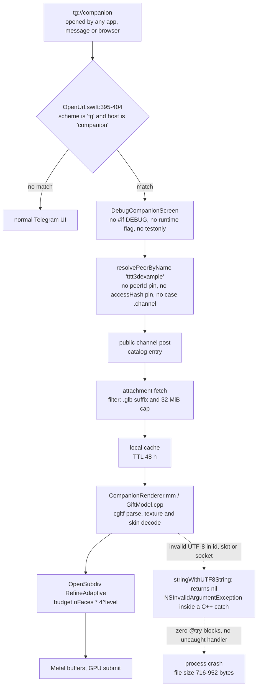
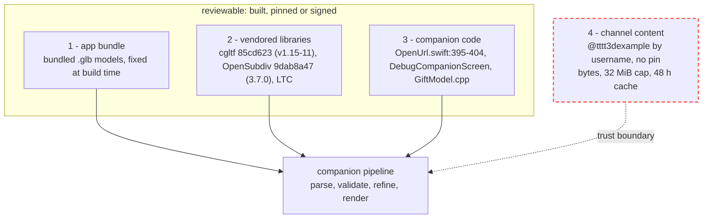

# Diagrams

Rendered by GitHub from the Mermaid sources below. Numbers and paths match
`FACTS.md`; both diagrams are descriptive, not executable.

## 1. Data flow: from deeplink to Metal

Stages: URL match, screen, peer lookup, attachment, parse, refine, render. The
dashed path is the failure branch from Finding 1; the four amplification
measurements of Finding 2 enter at `cgltf parse` and `RefineAdaptive`.

## 2. Trust model: four sources, one boundary

Sources 1-3 are reviewable artifacts: built, pinned by commit, or code-signed,
so a reader can diff them against a known revision. Source 4 is not an artifact
at all — it is whatever the channel owner posted, resolved by *name* at runtime.
The red edge is the trust boundary: bytes cross it on the strength of a username
lookup, with no `peerId` + `accessHash` pin, no `case .channel` check, and a
`GiftModel.cpp` filter that tests only the `.glb` suffix and a 32 MiB cap. The
48-hour cache means a warm client keeps reading the peer it already resolved
while a cold client switches to whatever the name points at now.
